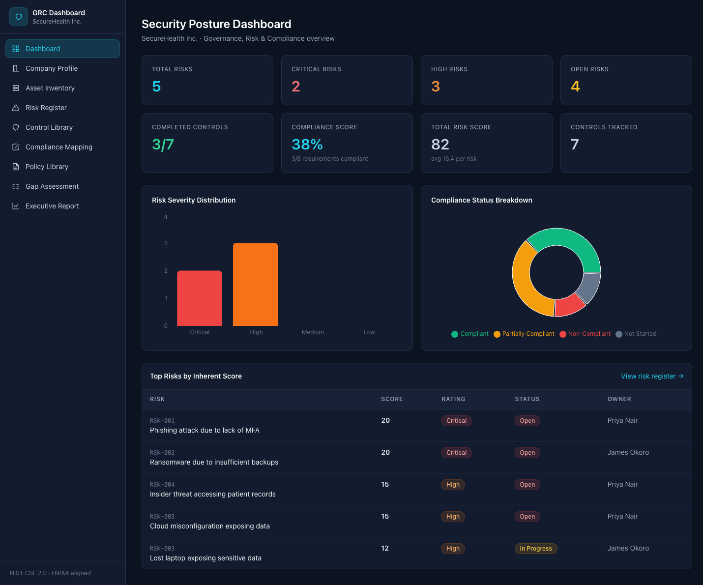
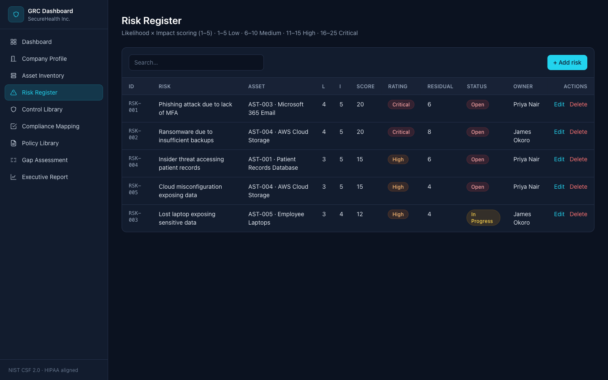
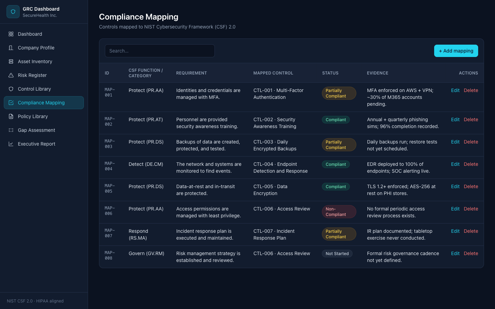
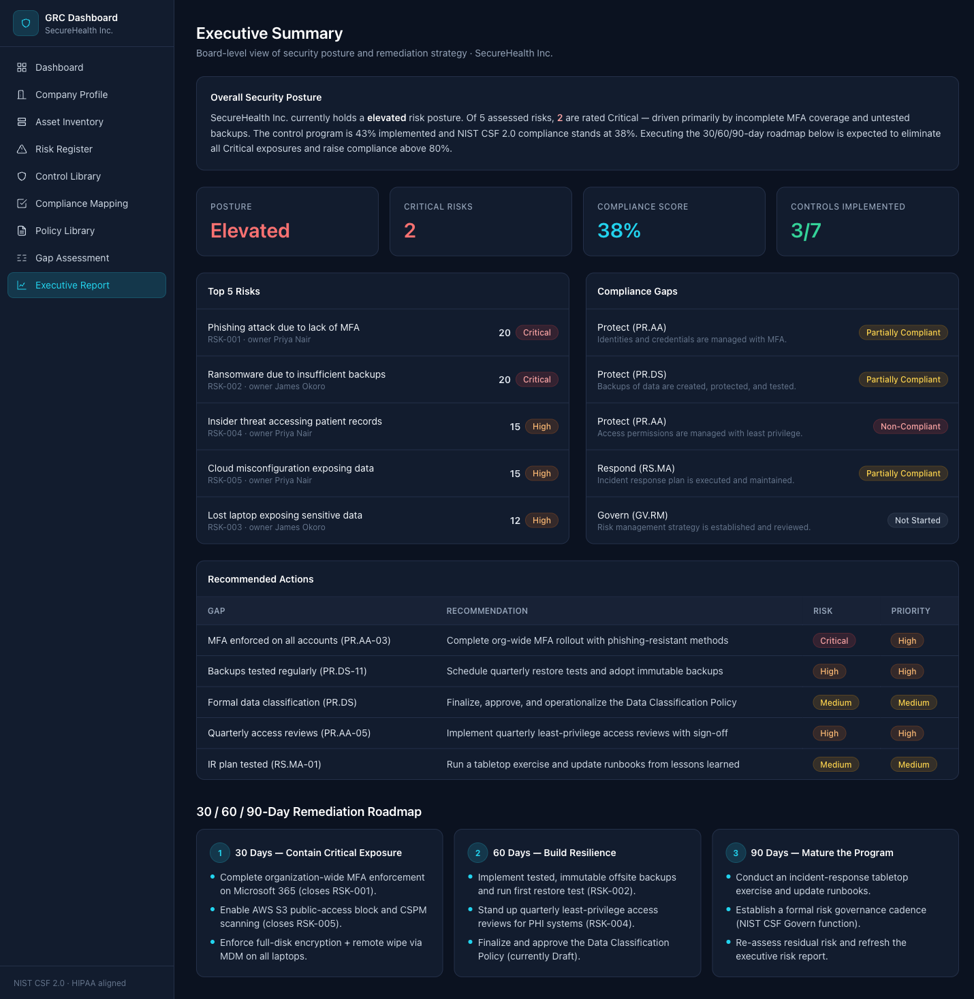

# GRC Risk & Compliance Dashboard

A full-stack **Governance, Risk & Compliance (GRC)** portfolio project built for a fictional healthcare company, **SecureHealth Inc.** It demonstrates the end-to-end workflow of a cybersecurity GRC Analyst: building an asset inventory, running a risk assessment, selecting controls, mapping them to **NIST CSF 2.0**, performing a gap analysis, documenting policies, and communicating results to executives.

> Built with Next.js + Supabase (PostgreSQL). Live, editable data — not static mockups.

---

## Why this project matters for GRC Analyst roles

GRC Analyst job descriptions repeatedly ask for the same competencies: risk registers, control frameworks (NIST/ISO), compliance mapping, gap assessments, policy writing, and executive reporting. This project shows all of them working together against a realistic healthcare scenario (PHI, HIPAA drivers, M365 + AWS + remote workforce) — the exact language hiring managers screen for. Instead of describing the skills on a résumé, it lets a reviewer *click through the actual workflow*.

---

## Features

| Page | What it demonstrates |
|------|----------------------|
| **Dashboard** | Total/critical/high/open risks, completed controls, compliance score, total risk score, risk-severity bar chart, compliance-status donut chart, top-risk table |
| **Company Profile** | The organization under assessment (SecureHealth Inc.) and its technology environment |
| **Asset Inventory** | CRUD inventory with owner, business criticality, and data classification |
| **Risk Register** | CRUD risks with Likelihood × Impact (1–5) auto-scoring and auto-rating (Low/Medium/High/Critical) |
| **Control Library** | CRUD controls typed as Administrative / Technical / Physical with framework references |
| **Compliance Mapping** | Controls mapped to NIST CSF 2.0 functions with Compliant / Partially / Non-Compliant / Not Started status |
| **Policy Library** | Six sample security policies (purpose, scope, statement, owner, review date) |
| **Gap Assessment** | Requirement → current state → gap → risk level → recommendation → priority |
| **Executive Report** | Posture summary, top 5 risks, compliance gaps, recommended actions, 30/60/90-day roadmap |

UI: clean sidebar navigation, dashboard stat cards, searchable tables, colored severity/status badges, Recharts visualizations, responsive dark cybersecurity theme.

---

## Tech Stack

- **Framework:** Next.js 14 (App Router) + React 18 + TypeScript
- **Styling:** Tailwind CSS (custom GRC dark theme)
- **Database:** Supabase (PostgreSQL 17)
- **Data access:** `@supabase/supabase-js` — server components read; client components perform CRUD
- **Charts:** Recharts

---

## Database Schema

Seven tables (see [`supabase/migrations/0001_schema.sql`](supabase/migrations/0001_schema.sql)):

| Table | Purpose |
|-------|---------|
| `company_profile` | Organization under assessment |
| `assets` | Asset inventory |
| `controls` | Control library |
| `risks` | Risk register (`inherent_risk_score` is a generated column = `likelihood * impact`) |
| `compliance_mappings` | Control → NIST CSF 2.0 mapping |
| `policies` | Policy library |
| `gap_assessments` | Gap analysis |

**Risk rating rule:** `score = likelihood × impact` → `1–5 Low · 6–10 Medium · 11–15 High · 16–25 Critical` (implemented in [`lib/scoring.ts`](lib/scoring.ts) and reflected in seed data).

---

## Supabase Setup

The app ships pointed at a pre-provisioned Supabase project with the schema and seed data **already applied**, so it runs immediately. To point it at your own project instead:

1. Create a project at [supabase.com](https://supabase.com).
2. In the SQL editor (or Supabase CLI) run, in order:
   - `supabase/migrations/0001_schema.sql`
   - `supabase/migrations/0002_rls.sql`
   - `supabase/seed.sql`
3. Copy `.env.example` to `.env.local` and set:
   ```
   NEXT_PUBLIC_SUPABASE_URL=<your project URL>
   NEXT_PUBLIC_SUPABASE_ANON_KEY=<your publishable/anon key>
   ```

> **Security note (portfolio tradeoff):** to keep the demo login-free, RLS policies in `0002_rls.sql` allow the anonymous role to read *and write*. In a production deployment you would gate writes behind Supabase Auth and restrict policies to authenticated users/roles.

---

## Run Locally

```bash
# 1. Install dependencies
npm install

# 2. Environment (already present as .env.local; or copy the template)
cp .env.example .env.local

# 3. Start the dev server
npm run dev
# open http://localhost:3000
```

Production build:

```bash
npm run build && npm start
```

---

## Screenshots

### Dashboard


### Risk Register


### Compliance Mapping (NIST CSF 2.0)


### Executive Report


---

## Skills Demonstrated

- Risk assessment & quantitative risk scoring (Likelihood × Impact)
- Risk register creation and lifecycle tracking
- Asset inventory & data classification
- Security control selection and typing (Administrative/Technical/Physical)
- Compliance mapping to **NIST CSF 2.0**
- Gap analysis & remediation prioritization
- Security policy documentation
- Executive communication (posture summary + 30/60/90 roadmap)
- Full-stack engineering: Next.js, TypeScript, PostgreSQL/Supabase, data modeling, RLS

---

## Future Improvements

- Supabase Auth with role-based access (analyst vs. viewer) and locked-down RLS
- Residual-risk heatmap and risk trend over time
- Evidence file uploads (Supabase Storage) per compliance mapping
- Additional frameworks (ISO 27001, SOC 2, HIPAA Security Rule crosswalk)
- PDF export of the executive report
- Audit log of record changes

---

*Fictional data. Built for portfolio/demonstration purposes.*
